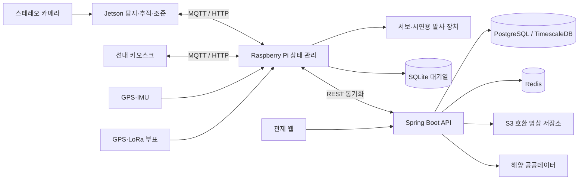

# FloaQ

AI 영상 탐지와 선내 장치 제어, 사고 기록 및 관제를 연결하는 해상 안전 시제품입니다.
Jetson이 사람을 탐지하고 조준 정보를 계산하면 Raspberry Pi가 장치 상태를 확인해
대응을 수행합니다. 선내 키오스크는 경보와 조작 화면을 제공하고, 서버와 관제 웹은
사고 이력, 선박 위치, 부표 위치와 해양 환경 데이터를 관리합니다.

이 저장소는 개발 소스를 공개 포트폴리오 형태로 정리한 스냅샷입니다.
모델 가중치, 촬영 영상, 개인 실험 기록, 장비별 실측 교정 파일과 실제 운영 설정은 포함하지 않습니다.
전체 코드를 독립 재작성한 프로젝트는 아니며, 원본 프로젝트와 별도의 Git 이력으로 관리합니다.

## 핵심 흐름

1. Jetson 카메라 프레임을 수집하고 사람·동물·부유체를 탐지합니다.
2. 추적과 스테레오 기하로 목표 위치 및 조준 정보를 계산합니다.
3. Pi가 사고 상태와 장치 상태를 관리하고 조준·투하 결과를 기록합니다.
4. 키오스크가 경보, 카운트다운, 취소, 수동 신고와 사고 진행 상태를 표시합니다.
5. GPS·LoRa 부표 위치와 통신 두절 상태를 갱신합니다.
6. SQLite에 저장된 엣지 기록을 REST API로 서버에 동기화합니다.
7. 관제 웹에서 사고 검색, 상태 변경, 영상 확인 및 해양 환경 조회를 제공합니다.

## 구성



선내 사고 처리와 클라우드 기록 조회는 통신 경계가 나뉘어 있습니다.
MQTT 계약은 `iot/pi/floaq/contracts/`, 화면 데이터 변환은 키오스크의
`src/pi/decode.ts`, 서버 동기화는 `backend`의 `pi` 도메인에서 확인할 수 있습니다.

## 저장소 구조

| 경로 | 내용 |
| --- | --- |
| [ai](ai/README.md) | 탐지 학습·평가·추적·스테레오 및 탄도 계산 |
| [iot/pi](iot/pi/README.md) | 장치 상태, MQTT 계약, 센서, SQLite 및 REST 동기화 |
| [iot/jetson](iot/jetson/README.md) | 카메라, 추론, 사고 영상 버퍼, Pi SDK |
| iot/buoy · iot/lora | 부표 GPS·LoRa 펌웨어와 통신 시험 |
| [backend](backend/README.md) | 사고·선박·사용자·해양 데이터 API |
| [frontend](frontend/README.md) | React 관제 웹, 선내 키오스크, 공유 컴포넌트 |
| [infra](infra/README.md) | 로컬 DB·캐시와 배포 예제 |
| database | Pi SQLite 스키마 |
| hardware | OpenSCAD 기구 원본과 출력 도구 |
| docs/api · docs/edge | 서버·엣지 인터페이스와 설계 기록 |

## 장비 없이 화면 실행

Node.js 24와 pnpm 11을 사용합니다. 명령은 저장소 루트에서 시작합니다.

```bash
cd frontend
pnpm install --frozen-lockfile
cp apps/web/.env.example apps/web/.env.local
pnpm --filter @floaq/kiosk dev:fixture
```

키오스크의 fixture 모드는 합성 데이터로 사고 시나리오를 재생합니다.
실제 카메라 추론이나 센서 입력을 검증하는 모드는 아닙니다.
관제 웹은 별도 터미널에서 `pnpm --filter @floaq/web dev`로 실행하고 아래 서버를 연결합니다.

## 서버 실행

JDK 21과 Docker Compose가 필요합니다.

```bash
cd infra
cp .env.example .env
# 로컬 DB 개발 계정은 compose와 application-local.yml의 floaq/floaq입니다.
docker compose up -d postgres redis
cd ../backend
./gradlew bootRun --args='--spring.profiles.active=local'
```

Windows에서는 `gradlew.bat`를 사용합니다. API는 `http://localhost:8080`,
Swagger UI는 `/swagger-ui.html`에서 확인합니다.
로컬 프로파일만 예제 계정을 생성하며 prod에서는 생성하지 않습니다.
외부 해양 API, 저장소 및 LLM은 사용자가 발급한 키와 엔드포인트를 설정해야 합니다.
LLM은 기본 비활성이고 키 없이 규칙 기반 요약으로 동작합니다.

## AI 및 실제 장비

- AI 학습 모듈은 Python 3.11과 uv를 사용합니다. 데이터셋과 모델은 별도로 준비합니다.
- Pi는 Python 3.13.5를 기준으로 하며 GPIO·I2C·UART 관련 의존성은 보드에서 설치합니다.
- Jetson은 JetPack의 Python 3.10.12와 시스템 OpenCV를 사용합니다. 해당 보드용
  ONNX Runtime wheel을 `iot/jetson/wheels/`에 준비한 뒤 의존성을 동기화합니다.
- 실측 카메라 교정과 서보·발사 파라미터는 자기 장비에서 측정해야 합니다.
- 이 프로젝트는 시제품입니다. README와 코드의 실험용 수치는 실선박 구조 성능을 보증하지 않습니다.

세부 설치·구동 조건과 현재 제약은 각 모듈 README를 참고합니다.

## 검증

```bash
python scripts/check_public.py
cd frontend
pnpm typecheck
pnpm build
pnpm --filter @floaq/kiosk check:mqtt
pnpm --filter @floaq/kiosk check:ocean
pnpm --filter @floaq/kiosk check:nav
pnpm --filter @floaq/kiosk check:chart
```

백엔드 단위 테스트는 backend에서 `./gradlew unitTest`를 사용합니다.
전체 통합 테스트는 DB·Redis를 준비한 뒤 `./gradlew test`로 실행합니다.
엣지와 AI 테스트는 각 모듈의 `tests/`를 사용합니다.
실행 결과와 실행하지 못한 장비 검증은 [검증 기록](docs/VALIDATION.md)에 남깁니다.

## 공개 범위

공개 사본에서 교육 실습, 내부 서버 정보, 비밀값, 기존 Git 이력과 개인 산출물을 제외했습니다.
세부 사항은 [공개 준비 기록](docs/PUBLICATION.md)에 있습니다.
기관의 공개 규정 및 공동 작업물의 공개 권한은 이 정리 작업만으로 확정되지 않습니다.
원본 코드의 저작권과 외부 의존성의 라이선스는 각각의 권리자에게 있으며,
별도의 오픈소스 라이선스를 임의로 부여하지 않았습니다.
