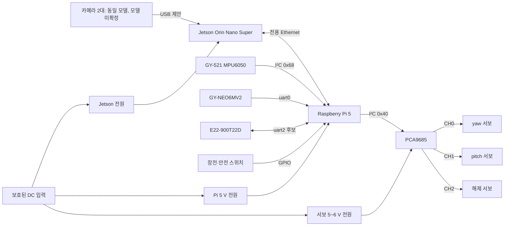

# DES-34 회로도 및 핀 배치

- Jira: floaq-122 · 에픽 floaq-85
- 선행: [DES-33 부품 목록](IoT_REVIEW_DES-33_부품선정.md) · DES-31 보드 사양 (`REVIEW_DES-31_엣지보드사양.md`, 공개 사본 미포함)
- 작성일: 2026-09-09 · 수정일: 2026-09-10
- 상태: **충돌 검토용 제안** — 모듈 데이터시트 확인 후 배선 승인 필요

이 문서의 핀맵은 소프트웨어·모듈 충돌을 미리 검토하기 위한 제안안이며 제작 승인용 최종 회로도가 아니다.

## 1. 장치 구성

| 장치 | 역할 | 인터페이스 |
|---|---|---|
| Jetson Orin Nano Super (8GB, 25W) | 양안 영상 수집, AI 추론 | USB 3, Ethernet |
| Raspberry Pi 5 Model B Rev 1.0 (4GB) | 센서·통신·발사 장치 총괄 제어 | Ethernet, I²C, UART, GPIO |
| 카메라 (모델 미확정) | 좌·우 영상 | USB 3 제안 |
| GY-521 MPU6050 | 선박 자세·진동 | I²C |
| GY-NEO6MV2 (NEO-6M) | 위도·경도·시각 | 3.3 V UART |
| E22-900T22D | 장거리 저속 송수신 | UART (대역·로직 레벨 확인 필요) |
| PCA9685 계열 PWM 드라이버 | yaw·pitch·해제 서보 PWM | I²C + 별도 서보 전원 |
| 상태 스위치 | 장전·안전 입력 | GPIO 풀업 입력 |

**추적 부표 측 (독립 계통, §12)**

| 장치 | 역할 | 인터페이스 |
|---|---|---|
| Arduino UNO | 부표 제어 | 하드웨어 UART 1개(USB 공유) + SoftwareSerial |
| GY-NEO6MV2 (NEO-6M) | 부표 위치 | 3.3 V UART |
| E22-900T22D | 위치 송신 (1초 주기) | UART, 3.3 V 로직 |
| 버튼 | 파지 여부 (`is_pressed`) | 디지털 입력, 내부 풀업 |
| LED · 부저 | 시인성 표시 | 디지털 출력 |

카메라와 PCA9685는 보유·모델 미확인이다. 보드 실측값은 DES-31에 있으며, 그중 GUI 상주·메모리 단편화·냉각 여유 해석은 이 회로도의 확정 근거로 쓰지 않는다.

## 2. 기준 블록 회로

## 3. 전원 도메인

| 도메인 | 부하 | 원칙 |
|---|---|---|
| `PWR-JETSON` | Jetson, 카메라 | 공식 입력 정격과 피크 소비전력 적용 |
| `PWR-PI` | Pi, 저전력 센서 로직 | 안정된 5 V, 저전압 경고 없는 여유 |
| `PWR-SERVO` | yaw, pitch, 해제 서보 | 5~6 V 별도 전원, 기동·스톨 전류 합산 후 정격 확정 |
| `LOGIC-3V3` | Pi GPIO, 호환 센서 로직 | Pi 허용 저전력 로직만 |

- 서보 전력을 Pi의 5 V 또는 3.3 V 핀에서 공급하지 않는다.
- PCA9685의 로직 `VCC`와 서보 전원 `V+`를 구분한다.
- 모든 장치의 신호 기준 GND를 한 지점에서 공통화한다.
- DC 입력에 퓨즈, 역극성 보호, 주 전원 스위치, 비상 차단 수단을 둔다.
- 서보 분기에 벌크 커패시터와 개별 분기 보호를 검토한다.
- Jetson·Pi 전원선을 서보 기동 전류 경로와 분리하고 스타 배선을 우선한다.
- 퓨즈·레귤레이터·전선 굵기는 [**DES-35 전원 설계**](IoT_REVIEW_DES-35_전원설계.md)에서 다룬다. 현재 예산안까지 나왔고, MG996R 실측 전류를 반영해 정격을 확정한다.

## 4. Pi 5 40핀 제안 배치

| 기능 | 신호 | BCM | 물리 핀 | 연결 | 비고 |
|---|---|---:|---:|---|---|
| I²C SDA | `SDA1` | GPIO2 | 3 | IMU, PCA9685 | 풀업 3.3 V 확인 |
| I²C SCL | `SCL1` | GPIO3 | 5 | IMU, PCA9685 | |
| GPS TX→Pi | `RXD0` | GPIO15 | 10 | GPS TX | 3.3 V 입력만 허용 |
| GPS RX←Pi | `TXD0` | GPIO14 | 8 | GPS RX | 설정 명령 없으면 미연결 가능 |
| E22 TX→Pi | `RXD2` | GPIO5 | 29 | E22 TXD | **후보**, §5 |
| E22 RX←Pi | `TXD2` | GPIO4 | 7 | E22 RXD | **후보**, §5 |
| 장전 감지 | `LOADED_N` | GPIO17 | 11 | 장전 스위치 | 내부 풀업, GND로 닫힘 |
| 안전 상태 | `SAFETY_N` | GPIO27 | 13 | 안전 스위치 | 내부 풀업, GND로 닫힘 |
| 예비 입력 | `FAULT_N` | GPIO24 | 18 | 고장 접점 | 사용 여부 미확정 |
| 3.3 V | `3V3` | — | 1, 17 | 호환 로직 전원 | 모듈 총전류 제한 확인 |
| GND | `GND` | — | 6, 9, 14 등 | 모든 로직 기준 | 커넥터별 GND 동반 |

E22의 `M0`/`M1`/`AUX`용 GPIO 3개를 추가 예약해야 한다. 배정은 제품 매뉴얼과 드라이버 요구사항 확인 후 확정한다.

## 5. E22 UART 경로 — uart2 후보 (확정 대기)

Pi 5는 GPIO 헤더에서 최대 5개 UART를 제공한다. **USB–UART 어댑터 구매는 불필요하다.**

| UART | TX / RX (BCM) | 물리 핀 | 현 핀맵과 충돌 |
|---|---|---|---|
| uart0 | GPIO14 / GPIO15 | 8 / 10 | GPS에 배정 |
| uart1 | GPIO0 / GPIO1 | 27 / 28 | ID EEPROM 용도, 회피 권장 |
| **uart2** | **GPIO4 / GPIO5** | **7 / 29** | **없음 — 후보** |
| uart3 | GPIO8 / GPIO9 | 24 / 21 | SPI0 CE0/MISO 겸용 |
| uart4 | GPIO12 / GPIO13 | 32 / 33 | 없음 |

uart2는 현 배정(GPIO2/3, 14/15, 17, 24, 27)과 충돌하지 않는다. `dtoverlay=uart2` 활성화와 장치 경로 확인이 필요하며, 실제 배정은 실물 시험 후 확정한다.

- 연결은 E22 `RXD` ← 호스트 TX, E22 `TXD` → 호스트 RX.
- **두 TX 출력을 같은 RX 핀에 묶지 않는다.**
- 모듈 전원과 로직 허용 전압을 별도로 확인한다.
- 국내 비면허 대역은 917~923.5MHz다. 모듈을 920~923MHz로 설정하고 해당 대역 안테나를 사용한다. 출력 22dBm(158mW)은 200mW 한도 안이지만 적합성인증과 듀티사이클 제한은 별개다.

## 6. I²C 주소 계획

| 장치 | 주소 | 확정 여부 |
|---|---|---|
| PCA9685 | `0x40` | 보드 점퍼 상태 확인 필요 |
| GY-521 MPU6050 | `0x68` (AD0=L) / `0x69` (AD0=H) | 데이터시트 확정 |

PCA9685와 MPU6050은 충돌하지 않는다.

**MPU6050은 주소가 2개뿐이므로 IMU 3개를 같은 I²C 버스에 올리는 것은 불가능하다.** 3개 동시 사용 시 두 번째 I²C 버스 또는 멀티플렉서가 필수다. 설치 위치와 사용 수량을 먼저 정한다. GPS·E22 각 2개의 선박/부표 배분도 미확정이다.

## 7. PWM 채널 배치 (자원 예약안)

서보는 총 3개(360 옵션 2개 + 보유 180° 1개)다. 수량이 3개라는 사실만으로 3축 위치제어가 보장되지 않는다. 360 옵션이 연속회전형이면 정지 펄스·속도 제어와 별도 위치 검출이 필요하다. 180° 제품을 위치제어용으로 구분하되 가동 범위·부하를 확인한다. PCA9685도 구매 확인 전이다.

| 채널 | 부하 | 초기 안전 상태 | 비고 |
|---:|---|---|---|
| CH0 | yaw 서보 | 출력 비활성 또는 검증된 중립 | -45°~+45° 목표, 실물 보정 필요 |
| CH1 | pitch 서보 | 출력 비활성 또는 최저 안전각 | 0°~45° 목표, 기구 간섭 확인 |
| CH2 | 잠금 핀 해제 서보 | 해제 반대 방향 | 부팅·재시작 시 핀을 당기지 않아야 함 |
| CH3~15 | 예비 | 출력 비활성 | 변경 기록 후 배정 |

PWM 신호가 존재한다는 이유로 발사를 허가하지 않는다. 잠금 상태, 안전 상태, 명령 유효성, 운영자 승인을 모두 통과한 뒤에만 CH2 해제를 수행한다.

## 8. 커넥터

| ID | 연결 | 최소 신호 | 표기 |
|---|---|---|---|
| J1 | DC 입력 | `VIN+`, `VIN-`, 섀시 접지 | 정격·극성 라벨 |
| J2 | Jetson 전원 | 모델별 전원·GND | 물리 키 구분 |
| J3 | Pi 전원 | 5 V, GND | 역삽입 방지 |
| J4 | 서보 전원 | 5~6 V, GND | 고전류용 커넥터 |
| J5 | IMU | 3.3 V, GND, SDA, SCL | 주소 표기 |
| J6 | GPS | 전원, GND, TX, RX | TX/RX 교차 표기 |
| J7 | E22 | VCC, GND, RXD, TXD, M0, M1, AUX | 로직 전압·UART 경로 표기 |
| J8 | 상태 스위치 | GND, `LOADED_N`, `SAFETY_N`, 예비 | 상시 닫힘/열림 명시 |
| J9~J11 | 서보 | V+, GND, PWM | yaw/pitch/release 색상 구분 |
| J12 | 카메라 | USB ×2 | 좌·우 표기, 바꿔 끼우면 시차 부호가 뒤집힌다 |

하네스 양 끝에 같은 신호명·커넥터 ID를 표시한다. 전원과 신호 커넥터는 형상 또는 키를 다르게 해 오삽입을 막는다.

## 9. 모델 확정 전 금지 사항

- 5 V 출력 모듈을 Pi GPIO에 직접 연결하지 않는다.
- 카메라 인터페이스(CSI/USB) 확인 전 케이블·포트를 확정하지 않는다.
- LoRa 대역과 안테나 정합 확인 전 송신하지 않는다.
- GPS·IMU 모듈에 레귤레이터나 레벨 시프터가 있다는 가정으로 전압을 인가하지 않는다.
- MG996R 호환품의 기동·스톨 전류를 인터넷 평균값으로 확정하지 않는다.
- Jetson과 서보를 하나의 미검증 레귤레이터에 병렬 연결하지 않는다.

## 10. 단계별 통전 검사

1. 전 부하 분리 상태에서 각 도메인 무부하 전압·극성 확인
2. Pi만 연결 — 저전압 경고, 대기 전류
3. I²C 센서 하나씩 연결 — 주소 스캔(`0x40`, `0x68` 기대), 충돌 기록
4. GPS 연결 — UART 전압, NMEA 수신
5. E22 — 안테나 연결 후 저출력·근거리 송수신
6. PCA9685 로직만 연결 — I²C 통신 확인
7. 서보 전원 별도 인가, **발사체·스프링 제거 상태**에서 CH0·CH1 소범위 시험
8. 해제 서보는 잠금 핀 분리 상태에서 부팅·재시작·오류 시 해제 방향으로 움직이지 않는지 확인
9. Jetson·카메라 독립 전원 검증 후 Ethernet 통신 확인
10. 전체 동시 구동에서 각 레일 최저 전압, 최대 전류, 온도 기록

## 11. 검증 기록표

| 시험 | 조건 | 기대 결과 | 측정값 | 판정 |
|---|---|---|---|---|
| Pi 5 V 레일 | 대기 / CPU 부하 | 저전압 경고 없음 | | |
| 서보 레일 | 1개 / 동시 기동 | 허용 전압 유지 | | |
| I²C | IMU + PCA9685 | 주소 충돌 없음 | | |
| uart0 | GPS 수신 | 깨짐 없는 NMEA | | |
| uart2 | E22 근거리 왕복 | 패킷 송수신 성공 | | |
| Ethernet | Jetson ↔ Pi | 고정 주소 통신·재연결 | | |
| 부팅 안전 | 전원 인가·재시작 | 해제 서보 임의 동작 없음 | | |

## 12. 추적 부표 회로 (Arduino UNO)

선박 측과 **전기적으로 완전히 분리된 독립 계통**이다. GND도 연결하지 않는다. 전원은 [DES-35 §3.2·§4](IoT_REVIEW_DES-35_전원설계.md)에 있다.

발사되는 링 모형에는 전자부품이 없다([DES-39 §3](IoT_REVIEW_DES-39_발사체설계.md)). 이 회로는 발사하지 않는 실물 크기 추적 부표에만 적용된다.

### 12.1 UART 배치 — UNO의 하드웨어 UART는 USB와 공유된다

UNO(ATmega328P)는 하드웨어 UART가 1개뿐이고 그것이 USB 시리얼과 같은 핀(D0/D1)이다. GPS와 E22 둘 다 UART이므로 배치를 정해야 한다.

| 장치 | 배치 | 이유 |
|---|---|---|
| **GPS (NEO-6M)** | **하드웨어 UART, D0(RX)/D1(TX)** | 연속 스트림이라 타이밍에 민감하다 |
| **E22-900T22D** | **SoftwareSerial, 송신 전용** | 부표는 수신하지 않는다. 1초 주기 송신은 타이밍을 코드가 통제한다 |

- **SoftwareSerial 인스턴스 2개로 동시 수신은 불가능하다**(한 번에 하나만 listen). GPS·E22를 모두 SoftwareSerial에 두는 구성은 채택하지 않는다.
- D0/D1을 GPS가 쓰므로 `Serial.print` 디버깅과 스케치 업로드가 충돌한다. **업로드 시 GPS TX 선을 분리한다.** 동작 확인은 수신측(Pi)에서 패킷을 보는 방식으로 한다.
- NEO-6M을 UBX 설정으로 **GGA·RMC만 출력**하게 줄인다. 기본값은 GGA/GLL/GSA/GSV/RMC/VTG를 모두 출력하고 특히 GSV가 위성 수만큼 길어진다. UART 부하와 SRAM 사용이 함께 줄어든다.

### 12.2 로직 레벨 — E22 RX에 분압 필수

E22의 통신 레벨은 3.3 V이며 모듈 문서에 5 V TTL 인가 시 손상 가능이 명시돼 있다. `VCC`를 5 V로 주더라도 통신 레벨은 3.3 V로 유지된다.

| 경로 | 처리 | 비고 |
|---|---|---|
| UNO TX → E22 `RXD` | **분압 필수** — 신호에 1 kΩ, GND에 2 kΩ | 5 V → 약 3.3 V |
| E22 `TXD` → UNO RX | 직결 가능 | UNO는 3.3 V를 HIGH로 인식 |
| E22 `VCC` | **5 V 레일** | 2.3~5.5 V 허용, ≥5.0 V에서 출력 파워 보장 |
| E22 `VCC` ← UNO 3.3 V 핀 | **금지** | UNO 3.3 V는 약 50 mA 한계, 송신 피크 95~105 mA |
| `M0` / `M1` / `AUX` | 디지털 3핀 예약 | 모드 설정·전송 완료 확인 |

### 12.3 제안 핀 배치

| 기능 | 핀 | 연결 | 비고 |
|---|---|---|---|
| GPS TX → UNO | D0 (`RX`) | NEO-6M TX | 하드웨어 UART |
| UNO → GPS RX | D1 (`TX`) | NEO-6M RX | 설정 명령용, 미연결 가능 |
| UNO → E22 `RXD` | D3 | 분압 경유 | SoftwareSerial TX |
| E22 `TXD` → UNO | D2 | 직결 | SoftwareSerial RX (미사용 예약) |
| E22 `M0` | D4 | | 모드 설정 |
| E22 `M1` | D5 | | 모드 설정 |
| E22 `AUX` | D6 | | 전송 상태 |
| 파지 버튼 | D7 | GND로 닫힘 | `INPUT_PULLUP` |
| 표시 LED | D8 | 저항 직렬 | |
| 부저 | D9 | | PWM 가능 핀 |

D0/D1은 USB와 공유되므로 §12.1의 업로드 절차를 지킨다. 배치는 실물 시험 후 확정한다.

### 12.4 SRAM 제약

ATmega328P의 SRAM은 **2 KB**다. GPS 파서(TinyGPS++ 등) + SoftwareSerial 버퍼 + 송신 버퍼가 함께 올라가면 여유가 크지 않다.

- 문자열 리터럴은 `F()` 매크로로 flash에 둔다.
- NMEA 문장을 GGA·RMC로 줄인다(§12.1).
- 원인이 보이지 않는 반복 리셋은 대개 SRAM 고갈이다. 여유 SRAM을 주기적으로 출력해 확인한다.

### 12.5 부표 송신 규격

| 항목 | 값 | 근거 |
|---|---|---|
| 송신 주기 | **1초** | 노션 §8 정책값 확정 |
| 페이로드 | `buoy_id`, `lat`, `lon`, `is_pressed`, `seq` | 노션 §7.3 |
| 두절 판정 | **1분** 미수신 = 60패킷 연속 누락 | 노션 §8 |
| 운용 주파수 | 920~923 MHz 설정 | §5 국내 대역 |

1초 주기가 실제 SF·대역폭 설정에서 성립하는지, 목표 거리에서도 유지되는지는 실측 항목이다. 미달 시 두절 판정 기준과 표류 범위 계산을 재검토해야 한다.

### 12.6 부표 측 통전 검사

1. UNO 단독 — USB 급전, 스케치 업로드 확인
2. GPS 연결 — D0/D1, NMEA 수신과 측위 획득 시간 기록
3. E22 `VCC`·GND만 연결 — 무부하 전압 확인
4. 분압 저항 실측 — UNO TX 측 전압이 3.3 V 근방인지 확인 **(연결 전)**
5. E22 신호 연결 후 안테나 장착 — 근거리 송신
6. Pi 측 uart2에서 패킷 수신 확인
7. 1초 주기 연속 송신 10분 — 누락·순번 확인, 레일 전압 강하 기록
8. 버튼·LED·부저 동작 확인
9. 방수 함체 조립 후 재확인 — 열, 안테나 위치 영향

## 13. 확정 대기 항목

- [x] Pi 5 및 Jetson 모델·RAM·전력 모드 (DES-31)
- [x] MPU6050 I²C 주소 (`0x68`/`0x69`)
- [ ] E22 UART 경로 최종 배정 (uart2 후보) 및 M0/M1/AUX 핀
- [ ] E22 설정 대역(920~923MHz), 로직 전압, 안테나 대역
- [ ] 전원 어댑터 정격과 부하 중 최대 전력
- [ ] 양안 카메라 모델과 USB/CSI 인터페이스
- [ ] GY-521·GY-NEO6MV2 입력 전압과 UART 로직 레벨
- [ ] PCA9685 보드와 서보 전원 단자 정격
- [ ] yaw·pitch·해제 서보의 실제 기동·스톨 전류
- [ ] 장전·안전 스위치 접점 방식과 고장 안전 방향
- [ ] IMU 3개 사용 시 두 번째 I²C 버스 또는 멀티플렉서
- [x] 케이블 퓨즈·레귤레이터·전선 굵기 예산 ([DES-35](IoT_REVIEW_DES-35_전원설계.md)) — 실측 후 정격 확정
- [ ] 추적 부표 핀 배치 실물 확정 (§12.3)
- [ ] E22 `M0`/`M1`/`AUX` 배정 — 선박 측·부표 측 양쪽
- [ ] 부표 분압 저항·벌크 커패시터 조달
- [ ] LoRa 1초 주기 실측 (§12.5)
- [ ] 케이블 길이·커넥터, 테더 라우팅 ([DES-36 §7](IoT_REVIEW_DES-36_선박장착.md))
- [ ] 최종 회로도 도구에서 네트 라벨·커넥터 번호 반영
