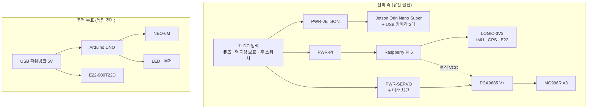

# DES-35 전원 설계

- Jira: floaq-123 · 에픽 floaq-85
- 선행: [DES-33 부품 목록](IoT_REVIEW_DES-33_부품선정.md) · [DES-34 회로도](IoT_REVIEW_DES-34_회로도.md) · DES-31 보드 사양 (`REVIEW_DES-31_엣지보드사양.md`, 공개 사본 미포함)
- 작성일: 2026-09-10
- 상태: **예산 제안** — 실측 전류 반영 후 정격 확정 필요

[DES-34 §3](IoT_REVIEW_DES-34_회로도.md)이 퓨즈·레귤레이터·전선 굵기 확정을 이 문서에 위임했다. 이 문서는 그 의존을 닫기 위한 예산안이며, 부품 정격을 확정한 승인 도면이 아니다.

**이 문서의 전류값은 대부분 카탈로그 참고값이다.** DES-34 §9는 "MG996R 호환품의 기동·스톨 전류를 인터넷 평균값으로 확정하지 않는다"고 금지하고 있다. 그 원칙을 유지한다. 아래 값은 배선·퓨즈 규격을 **보수적으로 고르기 위한 상한 추정**으로만 쓰고, §7 실측으로 대체한다.

---

## 1. 전원 계통 구조

선박 측과 부표 측은 **물리적으로 분리된 독립 계통**이다. 부표는 발사되거나 물에 띄우는 물건이므로 선박과 전기적으로 연결되지 않는다.

두 계통 사이에 GND 연결도 두지 않는다.

## 2. 선박 측 전원 도메인

[DES-34 §3](IoT_REVIEW_DES-34_회로도.md)의 도메인 정의를 그대로 상속한다.

| 도메인 | 전압 | 부하 | 분리 이유 |
|---|---|---|---|
| `PWR-JETSON` | 어댑터 정격 (미확인) | Jetson, USB 카메라 2대 | 추론 중 전압 강하가 프레임 드롭·재부팅으로 직결 |
| `PWR-PI` | 5 V | Pi 5, 액티브 쿨러 | 저전압 경고 시 USB 주변장치 전류가 제한된다 |
| `PWR-SERVO` | 5~6 V | MG996R ×3 (PCA9685 `V+`) | **기동·스톨 전류가 다른 레일을 끌어내린다** |
| `LOGIC-3V3` | 3.3 V | IMU, GPS, E22 로직 | Pi 3.3 V 총전류 한계 안에서만 |

### 절대 원칙

- **서보 전력을 Pi의 5 V·3.3 V 핀에서 뽑지 않는다.**
- PCA9685의 로직 `VCC`와 서보 전원 `V+`를 물리적으로 분리한다.
- 신호 기준 GND는 한 지점에서 공통화한다(스타 배선).
- 서보 기동 전류 경로와 Jetson·Pi 전원선을 같은 배선에 태우지 않는다.

## 3. 소비전력 예산 (카탈로그 참고값 — 실측 전 확정 금지)

### 3.1 선박 측

| 부하 | 수량 | 정상 | 피크 | 근거 |
|---|---:|---:|---:|---|
| Jetson Orin Nano Super | 1 | 유휴 **3.3 W 실측** | 25 W (mode 1 상한) | DES-31 §2 (`REVIEW_DES-31_엣지보드사양.md`, 공개 사본 미포함) 실측 / 전원 모드 |
| USB 카메라 | 2 | — | 각 최대 0.9 A @5 V (USB3 버스 파워) | USB 규격 상한. 실제 모델 미확정 |
| Raspberry Pi 5 | 1 | — | 5 V / 5 A (27 W) PD 권장 | 공식 권장 |
| MG996R | 3 | — | **각 2.5 A @6 V (카탈로그)** | 카탈로그값. §7-1로 대체 |
| PCA9685 로직 | 1 | 수 mA | — | |
| MPU6050 | 1 | 약 4 mA | — | |
| NEO-6M | 1 | 약 50 mA (측위 중) | — | |
| E22-900T22D | 1 | 수신 6~7 mA | **송신 95~105 mA** | 모듈 문서 |

**서보 레일 상한 산정**

| 시나리오 | 전류 | 설계 반영 |
|---|---:|---|
| 3개 동시 스톨 | 7.5 A | 이론 최악값 |
| 1개 스톨 + 2개 유지 | 약 4~5 A | **설계 기준** |
| 순차 구동 (설계 의도) | 약 2.5 A | 정상 운용 |

`SAFE→AIMING→ARMED→READY→RELEASED`([DES-38](IoT_REVIEW_DES-38_각도제어구조.md) 정본)는 yaw·pitch 조준을 끝낸 뒤 해제로 넘어가므로 **3축 동시 구동은 설계상 발생하지 않는다.** 다만 걸림·과부하 시 스톨은 동시에 날 수 있어 레일 정격은 "1개 스톨 + 2개 유지"로 잡는다.

### 3.2 추적 부표

발사되지 않는 기능 시연용 부표다. 발사체 링 모형에는 전원이 없다([DES-39 §3](IoT_REVIEW_DES-39_발사체설계.md)).

| 부하 | 정상 | 피크 | 비고 |
|---|---:|---:|---|
| Arduino UNO (보드 전체) | 약 45~50 mA | — | ATmega328P + 레귤레이터 + 전원 LED |
| NEO-6M | 약 50 mA | 측위 획득 시 상승 | 콜드 스타트가 가장 오래 걸린다 |
| E22-900T22D | 수신 6~7 mA | **95~105 mA** | 1초 주기 송신, 에어타임만 피크 |
| 표시 LED · 부저 | 20~50 mA | — | 기획의 신호탄·발열팩을 대체하는 구현물 |
| **합계 추정** | **약 120~150 mA** | 순간 250 mA | |

**배터리 용량**

1초 주기 송신은 에어타임이 짧아 평균 전류에 거의 기여하지 않는다. 평균 150 mA로 잡으면,

| 목표 연속 운용 | 필요 용량 | 여유 1.5배 |
|---|---:|---:|
| 1시간 | 150 mAh | 225 mAh |
| 3시간 | 450 mAh | 675 mAh |
| 8시간 (시연일 전체) | 1,200 mAh | 1,800 mAh |

**USB 파워뱅크 권장.** 흔한 5,000 mAh 제품이면 여유가 충분하다.

이유는 UNO의 전원 경로 때문이다.

- **VIN(7~12 V) 입력은 리니어 레귤레이터**를 지난다. 9 V를 넣으면 전압차 4 V × 150 mA가 그대로 열로 버려지고, 방수 함체 안에서는 이 열이 빠지지 않는다.
- **9 V 건전지는 부적합하다.** 용량이 약 500 mAh이고 내부저항이 커서 E22 송신 피크에서 전압이 주저앉는다.
- 파워뱅크 → USB 케이블 → UNO가 가장 단순하고, 5 V를 E22 `VCC`와 공유할 수 있다.

**저전력이 필요해지면** E22의 슬립(1~3 nA)과 UNO 전원 LED 제거를 검토한다. 현재 목표에서는 불필요하다.

## 4. 부표 측 전원 배선 — 반드시 지킬 것

[DES-34 §13](IoT_REVIEW_DES-34_회로도.md)의 회로와 함께 본다.

| 항목 | 규칙 | 이유 |
|---|---|---|
| E22 `VCC` | **5 V 레일에서 직접** | 모듈 허용 2.3~5.5 V이고 문서에 "≥5.0 V에서 출력 파워 보장" |
| E22 `VCC`를 UNO 3.3 V 핀에서? | **금지** | UNO의 3.3 V는 USB 인터페이스 칩에서 나와 약 50 mA가 한계다. 송신 피크 95~105 mA를 못 버틴다 |
| 벌크 커패시터 | E22 `VCC`–`GND` 근처에 100 µF 이상 + 0.1 µF | 송신 피크에서 레일이 흔들리면 패킷이 깨진다 |
| UNO TX → E22 `RXD` | **분압 필수** (신호 1 kΩ, GND 2 kΩ) | E22 통신 레벨은 3.3 V. `VCC`가 5 V여도 변하지 않는다 |
| E22 `TXD` → UNO RX | 직결 가능 | UNO는 3.3 V를 HIGH로 읽는다 |

> **이 증상이 가장 흔하다**: 부팅과 GPS 수신은 정상인데 첫 송신에서 리셋되거나 패킷이 깨진다. 원인은 거의 항상 E22를 3.3 V 핀에서 급전한 것, 또는 벌크 커패시터가 없는 것이다.

## 5. 보호 소자와 전선

정상 부하가 아니라 **피크 기준**으로 고른다. 값은 §7 실측 후 확정한다.

| 레일 | 설계 전류 | 퓨즈 (제안) | 전선 (짧은 배선 기준) |
|---|---:|---:|---|
| J1 주 입력 | 합산 피크 | 합산 후 결정 | AWG16 이상 |
| `PWR-SERVO` | 4~5 A (1스톨+2유지) | **7.5 A** | **AWG18 이상** |
| `PWR-PI` | 5 A | 7.5 A | AWG20 |
| `PWR-JETSON` | 어댑터 정격 | 어댑터 정격의 1.5배 | 어댑터 케이블 |
| 부표 5 V | 0.25 A | 0.5 A (선택) | AWG24 |

- AWG 값은 **장치 내부 짧은 배선(chassis wiring)** 기준이다. 길게 끌면 전압 강하로 다시 계산한다.
- 퓨즈는 정상 전류의 1.5~2배가 원칙이지만, 서보처럼 기동 돌입이 있는 부하는 **속단형을 쓰지 않는다**(정상 기동에 끊긴다).
- J1에 역극성 보호를 둔다.

## 6. 비상 차단

[DES-38](IoT_REVIEW_DES-38_각도제어구조.md)의 안전 원칙을 전원 회로로 구현한다.

| 수단 | 위치 | 동작 |
|---|---|---|
| 주 전원 스위치 | J1 직후 | 전 계통 차단 |
| **서보 V+ 비상 차단** | `PWR-SERVO` 분기 | **로직은 살리고 구동만 죽인다** |
| ARM 스위치 | GPIO 입력 (`SAFETY_N`) | 소프트웨어 허가 조건 |

서보 V+ 차단이 핵심이다. 로직이 살아 있으면 Pi가 차단 사실을 기록하고 상태를 `FAULT`로 보고할 수 있다. 전 계통을 끊으면 무슨 일이 있었는지 남지 않는다.

**부팅·재시작 시 해제 서보가 움직이지 않아야 한다.** 전원 인가 순서를 로직 먼저, 서보 V+ 나중으로 두고, PCA9685 출력이 비활성인 것을 확인한 뒤 V+를 올린다. 이 순서는 [DES-34 §10](IoT_REVIEW_DES-34_회로도.md) 단계별 통전 검사 8번과 같은 항목이다.

## 7. 측정 계획 — 이 문서를 확정하는 조건

| # | 항목 | 방법 | 목적 |
|---:|---|---|---|
| 1 | **MG996R 실측 기동·스톨 전류** | 전류계 직렬, 무부하 → 부하 → 강제 정지 | 서보 레일 정격·퓨즈 확정. **카탈로그값 대체** |
| 2 | 3축 순차 구동 시 레일 최저 전압 | 오실로스코프 또는 전압 기록 | 벌크 커패시터 용량 |
| 3 | Jetson 어댑터 라벨 확인 | 육안 | `PWR-JETSON` 정격 (DES-31 §7 (`REVIEW_DES-31_엣지보드사양.md`, 공개 사본 미포함) 미확인 항목) |
| 4 | Jetson MAXN SUPER 부하 전력 | `tegrastats` VDD_IN | 모드 승격 가능 여부 |
| 5 | Pi 5 부하 중 `get_throttled` | 부하 시험 중 주기 기록 | 저전압 판정 |
| 6 | 부표 평균·피크 전류 | 전류계, 10분 연속 | 배터리 용량 확정 |
| 7 | E22 송신 시 부표 레일 강하 | 전압 기록 | 커패시터 용량 검증 |
| 8 | 전체 동시 구동 각 레일 최저 전압·온도 | 기록 | 최종 정격 확정 |

## 8. 확정 대기

- [ ] **MG996R 실측 전류** ← 서보 레일 전체가 여기에 걸려 있다
- [ ] Jetson 전원 어댑터 정격
- [ ] PCA9685 보드의 `V+` 단자 허용 전류
- [ ] 카메라 모델과 USB 전류 (버스 파워 / 셀프 파워)
- [ ] 선박 측 급전 방식 — 유선 어댑터 / 배터리 / 겸용
- [ ] 부표 파워뱅크 모델과 방수 함체 내부 배치
- [ ] Pi 5 액티브 쿨러 전류
- [ ] 퓨즈 종류(속단·지연)와 홀더

## 9. 이 문서에서 다루지 않은 것

- 실제 선박 전원 계통 연동(DC 24 V 선박 버스, 절연) — 60 cm 모형 시연 범위 밖
- 방수 커넥터 선정과 함체 내부 열 설계 — [DES-36](IoT_REVIEW_DES-36_선박장착.md)
- 배터리 충방전 보호회로 설계 — 완제품 파워뱅크의 내장 보호에 의존
- 낙뢰·서지 보호

---

*전류값은 명시한 것을 제외하면 카탈로그·모듈 문서 참고값이다. §7 실측으로 대체하기 전에는 퓨즈·전선·레귤레이터를 발주하지 않는다. Jetson 유휴 3.3 W와 E22 전류만 근거 문서가 있는 값이다.*
