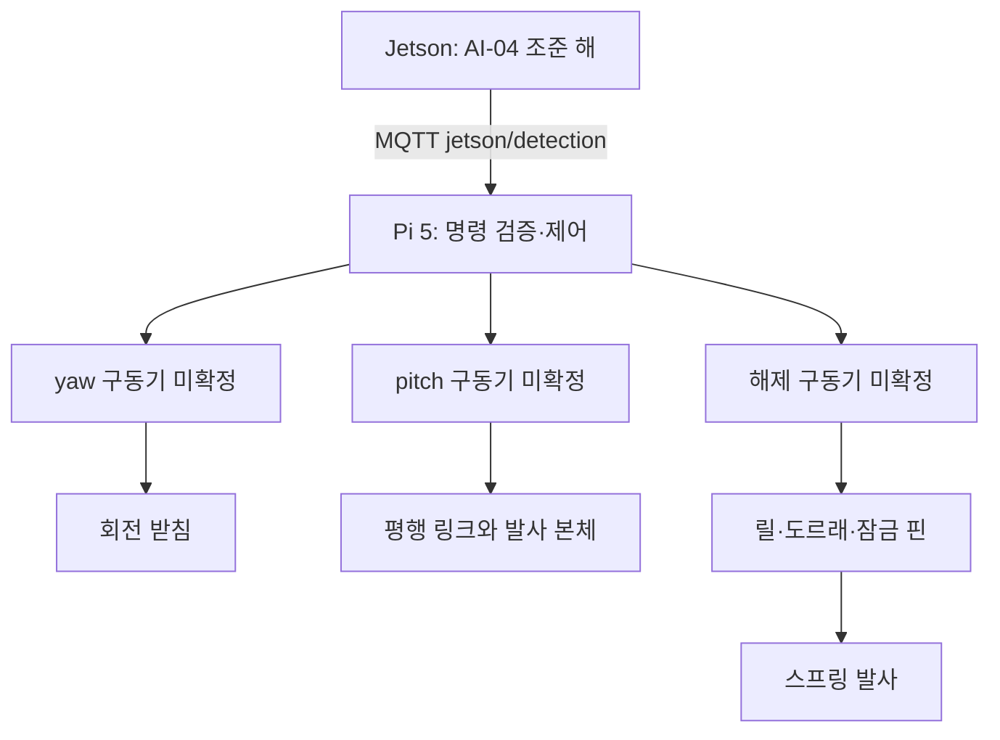
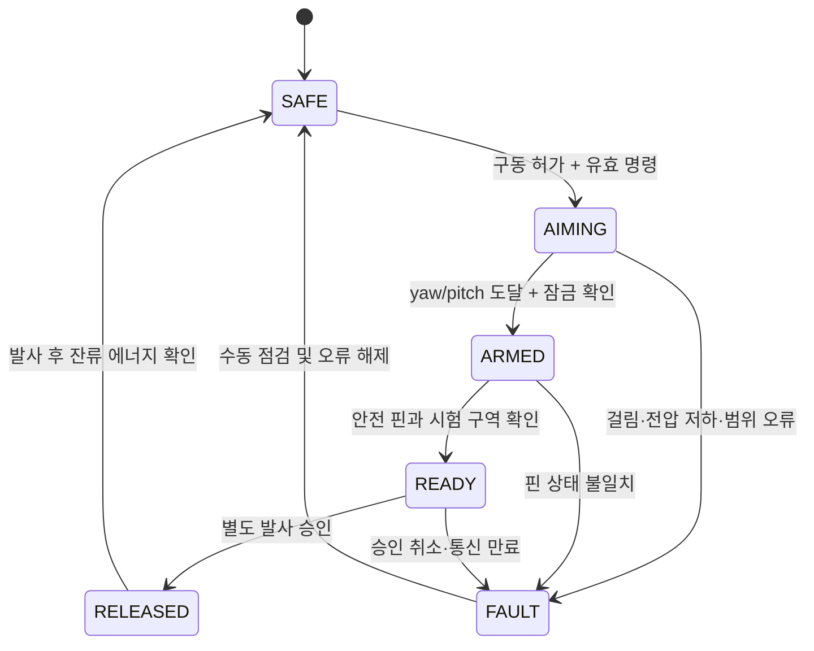

# DES-38 사거리·각도 제어 구조 설계

- Jira: floaq-126
- 선행: [DES-33 부품 목록](IoT_REVIEW_DES-33_부품선정.md) · [DES-37 발사 메커니즘](IoT_REVIEW_DES-37_발사메커니즘.md)
- 연계: AI-04 투하 위치 계산 (초안의 `AI-06` 은 오기 — 기획서 §4.1 에서 AI-06 은 카메라 이물질 확인)
- 작성일: 2026-09-09 · 수정일: 2026-09-10
- 상태: 위치 제어 구성 미확정 · 서보 토크 검증 필요

이 문서가 **안전 상태 머신의 정본**이다. 다른 문서는 §6 명칭을 따른다.

## 1. 제어 범위

설계 목표는 yaw·pitch 조준이다. 주문 MG996R 360 2개가 위치 제어를 지원하는지 확인되지 않았다. 연속회전형이면 목표 각도를 직접 지정할 수 없어 위치 피드백 추가 또는 위치제어 구동기 확보가 필요하다.

| 축·동작 | 구현 | 명목 범위 | 비고 |
|---|---|---:|---|
| yaw | 구동기 미확정 + 4인치 회전 베어링 | -45°~+45° | 유격 실측 필요, §4 |
| pitch | 구동기 미확정 + 평행 링크 | 0°~45° | 626ZZ 베어링과 Ø6 축으로 하중 지지 |
| 발사력 | 압축 스프링 | 보정 프로파일 | 자동 연속 제어 범위 밖. 실측 대기 |
| 해제 | Ø4 잠금 핀 인출 | 목표 상승 38 mm | 수동 우선. 토크 검증 필요, §3 |
| 재장전 | 작업자 수동 | — | 자동 장전 범위 밖 |

## 2. 기구 구성

서보는 총 3개(360 옵션 2개 + 보유 180° 1개)로 수량 부족은 아니다. 다만 180° 위치제어형 1개와 형식 확인이 필요한 360 옵션 2개를 구분하며 축별 배분은 미확정이다. 부팅 시 구동 미허가를 유지하고, 명령 전송과 실제 도달 확인을 구분한다. Pi 5의 CPU 사양만으로 제어 주기나 안전 상태 전이 지연이 보장되지는 않는다.

## 3. 해제 링크 — 토크 검증 필요

| 항목 | 값 |
|---|---|
| 릴 명목 감김 반경 | 16 mm |
| 잠금 핀 목표 상승량 | 38 mm |
| 38mm 상승에 필요한 회전각 | **136.08°** |
| 140° 회전 시 감김 길이 | 39.095 mm |
| 여유 | **3.9° = 1.1 mm (약 3%)** |

여유 3%로는 줄 늘어남, 감김 시 유효 반경 변화(줄 두께만큼 반경 증가), 초기 느슨함을 흡수하기 어렵다. 회전각을 160~170°로 늘리거나 릴 반경을 키우는 안을 검토한다. 아래 토크 문제와 상충하므로 함께 최적화한다. **확정 대기.**

### 서보 토크 대조

[DES-37 §4](IoT_REVIEW_DES-37_발사메커니즘.md)의 스프링 하중이 잠금 핀에 전단으로 걸린다. 축방향 인출력은 마찰이 지배한다.

| 항목 | 값 |
|---|---|
| 핀 전단하중 | 215~536 N |
| 마찰계수 가정 | 0.2~0.4 |
| 필요 인출력 | 43~214 N |
| **필요 토크 (릴 16mm)** | **0.69~3.43 N·m = 7.0~35 kgf·cm** |
| MG996R 스톨 토크 | 9.4 kgf·cm (4.8V) / 11 kgf·cm (6V) |
| MG996R 환산 인출력 한계 | 약 106 N |

가장 유리한 조합(활동권수 20 + 마찰 0.2)에서만 여유가 있고 중간값 이상에서는 **정격 초과**다.

조치: 무스프링 상태에서 핀 인출력을 실측하고, 스프링 하중을 단계적으로 올려가며 기록한다. 릴 반경 확대(토크 요구 감소, 회전각 증가) 또는 캠·레버 방식의 기구 이득 확보를 병행 검토한다. 회전각만으로 해제를 판정하지 않는다. 안전 핀은 자동으로 제거하지 않는다.

## 4. pitch·yaw 기구

### pitch 평행 링크

- 본체 회전축 중심: 본체 뒤에서 82 mm, 받침 바닥에서 85 mm
- 서보와 본체 크랭크 반경: 각 20 mm
- 회전 중심 및 연결봉 홀 간격: 50 mm
- 서보 출력축이 아닌 금속 축과 베어링이 본체 하중을 지지한다

크랭크 반경이 같고 홀 간격이 회전 중심 간격과 일치하므로 평행사변형이 성립하며 서보 각 = 본체 각(1:1)이다. 0~45° 구현에 서보 45° 회전이 필요하다.

**서보 필요 토크를 계산할 근거가 없다.** 발사 본체(스프링·슬라이더·밀대·링 포함) 조립 질량과 회전축 기준 무게중심 거리가 어느 문서에도 없다. 베어링이 하중을 지지한다는 서술은 반력 경로 설명이며 서보 부담을 0으로 만들지 않는다. 실측 후 정적 토크를 계산해 MG996R 정격과 대조한다. **확정 대기.**

### yaw 회전 받침

사각 Lazy Susan은 볼 유지 구조상 반경·축방향 유격이 크다. 위치 피드백이 없는 상태에서는 보정표를 만들어도 재현성이 확보되지 않는다.

조치: 조립 후 다이얼 게이지로 회전 유격을 실측해 yaw 각도 오차 예산에 포함한다. 유격이 크면 626ZZ 2개를 쓰는 Ø6 수직축 베어링 구성으로 대체 검토한다.

## 5. AI–IoT 파라미터

**조준 해는 Jetson 이 계산해 Pi 로 보낸다** `확정` (2026-09-11). 스테레오 거리·선박 GPS·침로가 Jetson 에 모여 있으므로 Pi 가 다시 계산하지 않는다.

**전송 규격의 정본은 [`mqtt.md`](mqtt.md) §5.1 이다.** 조준 해는 독립 메시지가 아니라 `jetson/detection` 페이로드 안의 `launch` 블록으로 실린다(토픽을 나누면 MQTT 가 도착 순서를 보장하지 않아 Pi 가 버퍼링해야 한다). 아래는 **IoT 측 처리 규칙**이며 필드명·형식은 mqtt.md 를 따른다.

| 필드 | 형식 | IoT 처리 |
|---|---|---|
| `request_id` (Envelope) | UUID v7 | 중복 명령 거부, 이력 추적 |
| `detection_id` | UUID v7 | 어느 탐지의 해인지. `pi_launch` 에 기록 |
| `solved_at` | Unix epoch 초 | 만료 명령 거부 (기준 `미정`⚠️, 제안 3초) |
| `target_yaw_deg` | degree | 보정 범위 밖이면 거부 |
| `target_pitch_deg` | degree | 보정 범위 밖이면 거부 |
| `launch_profile` | 등록 문자열 | 미등록 프로파일 거부 |
| `confidence` | 0.0~1.0 | 합의 임계값 미만이면 구동 금지 |
| `launch` 자체가 `null` | — | 탐지는 유효하나 조준 불가. 발사하지 않고 `NO_SOLUTION` 으로 보고 |

> ⚠️ 초안은 `issued_at` 을 타임존 포함 ISO 8601 로 정의했으나, mqtt.md §0 이 모든 시각을 **Unix epoch 초 정수**로 통일했으므로 `solved_at` 으로 맞췄다. Pi SQLite 가 STRICT 라 형식이 갈리면 INSERT 단계에서 갈린다.
>
> ⚠️ **선박 대지속도·침로가 조준 해의 입력에 포함되어야 한다.** 발사대가 움직이는 배 위에 있으므로 목표점은 "탐지 시점의 사람 위치"가 아니라 "착수 예상 시점의 사람 위치"다. 10노트면 1초에 약 5m 이동한다. `kiosk/sensor/gps` 의 `speed_kn`·`heading_deg` 가 Jetson 에 이미 전달되고 있다(mqtt.md §2). 발사 순간 선체 자세(IMU roll/pitch) 반영 여부는 **미정**⚠️ — 넣으려면 `pi/sensor/imu` 를 Jetson 이 구독해야 한다.

AI가 임의의 힘 값을 직접 모터 출력으로 전달하지 않는다. IoT는 실물 시험으로 승인된 `launch_profile`만 선택한다. `demo-low-v1`은 예시이며 검증 기록이 없다.

## 6. 안전 상태 머신 (정본)

거부 조건: 보정표 부재, 범위 오류, 만료·중복 명령, 장전 상태 불일치, 안전 승인 부재, 서보 전압 저하·과열·걸림, 미승인 프로파일.

## 7. 전원 원칙

- PCA9685 보유 여부와 각 축 구동기는 미확정이다.
- 로직 VCC와 서보 V+를 분리하고 GND를 공통으로 연결한다.
- Pi의 3.3 V 핀에서 서보 전력을 공급하지 않는다.
- 여러 서보 동시 기동 시 전압 강하와 최대 전류를 실측한다.
- 부팅 시 구동 허가 기본값은 `false`다.

## 8. 보정 절차

먼저 구동기의 위치제어/연속회전 형식을 확인한다. 아래 각도–PWM 보정은 위치제어형 절차다. 연속회전형이면 위치 센서·원점 검출·정지 로직을 먼저 설계하고 그 결과로 절차를 개정한다.

1. 스프링과 발사체를 제거하고 기계 간섭을 확인한다.
2. 혼을 분리한 채 서보 중립과 회전 방향을 확인한다.
3. 작은 범위부터 실제 각도와 PWM 펄스를 기록한다.
4. 검증된 각도 한계와 케이블 여유를 소프트웨어 제한으로 저장한다.
5. DES-37 §4 실측을 통과한 스프링과 DES-39 모형으로 거리 시험한다.
6. 같은 조건을 최소 5회 반복해 첫 접촉 거리의 평균과 범위를 기록한다.
7. 튕기거나 굴러간 최종 위치는 사거리로 사용하지 않는다.

| 날짜 | 모형 질량(g) | yaw(°) | pitch(°) | 프로파일 | 1~5회 첫 접촉 거리(cm) | 평균(cm) | 이상 |
|---|---:|---:|---:|---|---|---:|---|
| | | | | demo-low-v1 | | | |

## 9. 승인 기준

발사력은 실시간 연속 제어하지 않는다. 실측 전에는 각도–거리 관계를 확정할 수 없고, 위치 피드백 센서가 없으면 명령각과 실제 본체 각도가 같다고 보장할 수 없다. 자동 장전, 발사 완료 센서, 독립 비상정지 회로는 별도 설계 대상이다.

- [ ] **잠금 핀 인출력 실측 및 서보 정격 대조 (§3)** ← 차단 항목
- [ ] **발사 본체 질량·무게중심 실측 및 pitch 서보 토크 계산 (§4)**
- [ ] 릴 반경·회전각 재설정으로 상승량 여유 확보
- [ ] yaw 회전 유격 실측 및 오차 예산 반영
- [ ] 구동기 형식(위치제어/연속회전) 확인 및 축별 배분 확정
- [ ] yaw/pitch 실측 보정표 작성
- [ ] 전 구간 기구·케이블 간섭 없음
- [ ] 범위·만료·중복 명령 거부 시험
- [ ] 잠금 핀 상승량 38 mm와 원활한 인출 확인
- [ ] 비상 정지와 전원 재인가 시 자동 발사하지 않음
- [ ] 프로파일별 반복 거리 기록
